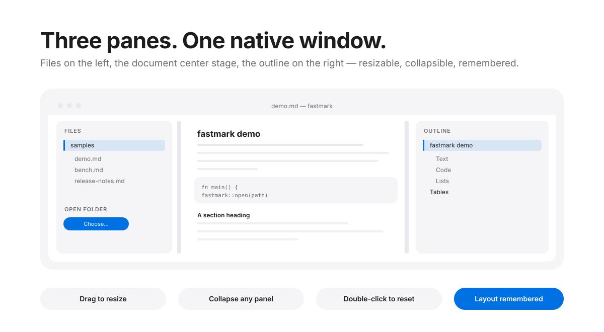
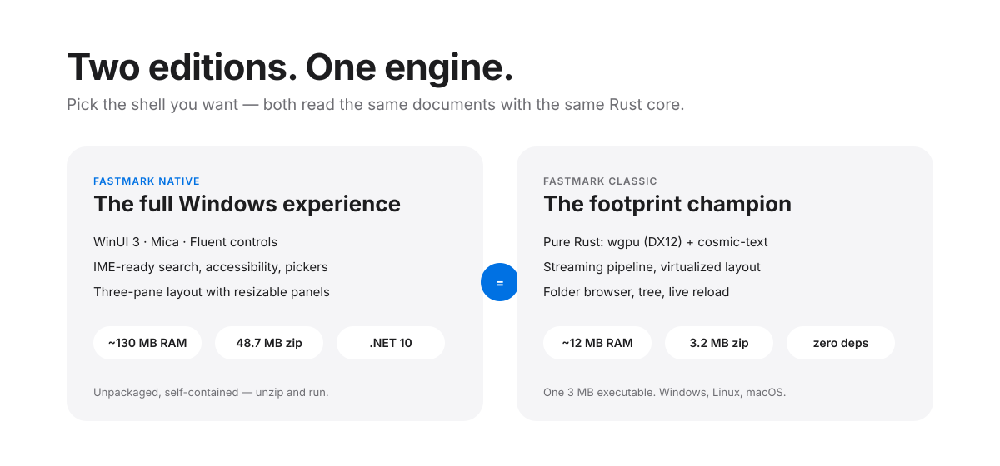
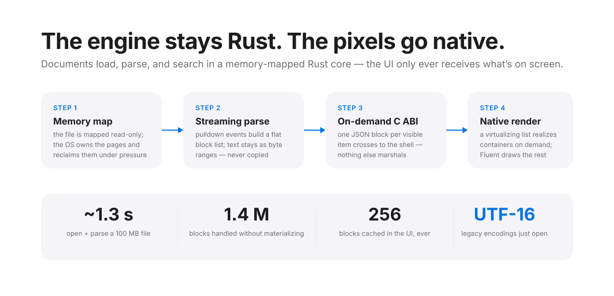

# fastmark

**The Markdown viewer for people who open big files.** A memory-mapped Rust
engine meets a real Windows shell: 100 MB documents open in about a second,
scroll at native speed, and the app stays out of the way.

[](https://github.com/dparksports/fastmark/actions/workflows/ci.yml)
[](LICENSE)




## Two editions, one engine



- **fastmark native** — the WinUI 3 shell (Mica, Fluent controls, IME-ready
  search, accessibility, native pickers and dialogs) over the same Rust core
  through a small C ABI. Unzip and run; no installer, no runtime to install.
- **fastmark classic** — the pure-Rust viewer (wgpu/DX12 + cosmic-text):
  a single ~3 MB executable that idles at ~12 MB of RAM, and builds on
  Windows, Linux, and macOS.

Both ship in [every release](https://github.com/dparksports/fastmark/releases).

## How it stays fast



1. **Memory-map, never copy.** UTF-8 files are mapped read-only; every
   rendered glyph is a slice of the mapping. Legacy files (UTF-16, ANSI)
   are detected and transcoded once.
2. **Stream the parse.** [pulldown-cmark] events build a flat block list
   where text stays as byte ranges — no DOM, no AST, no second copy.
3. **Send only what's visible.** The native shell receives one small JSON
   block per *realized* list container; a 256-entry LRU keeps the UI's
   memory flat no matter how large the document is.
4. **Search in the engine.** Folder-wide find mmaps each file in turn and
   streams results with file:line and snippet.

## Features

- Three-pane window: file browser (left), document (center), outline
  (right) — each panel resizable with drag splitters and collapsible;
  layout remembered across sessions
- Markdown: headings, emphasis, inline code, links, strikethrough, code
  blocks, quotes, nested/task lists, rules, GFM tables, images
- Outline that tracks what you read; click to jump
- Folder-wide keyword search across every file; results jump to the hit
- Light/dark following the system; per-window override
- Native folder/file pickers, error dialogs, and (classic) live reload on
  file change with scroll anchoring
- Classic extras: incremental in-document find, zoom, drag-and-drop

## Keyboard

| Key | Action |
|---|---|
| typing in search box | search every file in the folder (Enter) |
| `Enter` / click | open file / jump to hit / outline jump |
| Files / Outline toggles | show or hide the side panels |
| classic: `Ctrl+F` | find within the open document |
| classic: `Ctrl+O` | choose a folder |

## Measured (CI, windows-latest, release builds)

| Document | Blocks | Load (mmap) | Parse | First screen |
|---|---|---|---|---|
| demo.md (1.8 KB) | 34 | 0.1 ms | 0.3 ms | 17 ms |
| synthetic 25 MB | 354,071 | 9.9 ms | 267.5 ms | 94.6 ms |

The engine never lays out the whole document — see the [bench job] for live
numbers on every push.

## Repository layout

```
crates/fastmark-core     platform-independent engine: mmap loader, encoding
                         detection, streaming parser, search, position index
crates/fastmark-ffi      C ABI over the core (JSON-per-block) for the shell
crates/fastmark-app      fastmark classic: pure-Rust wgpu viewer
dotnet/Fastmark.App      fastmark native: WinUI 3 shell
docs/                    infographics (this page) + engine diagrams
samples/                 demo + bench documents
```

## Building

```bash
# classic (any platform)
cargo build --release            # → target/release/fastmark(.exe)

# native (Windows, .NET 10 SDK)
cargo build --release -p fastmark-ffi
dotnet build dotnet/Fastmark.App/Fastmark.App.csproj -c Release
```

Benchmarks: `fastmark --bench-gen 102400 > big.md && fastmark --bench big.md`
(classic).

## License

Apache-2.0 — see [LICENSE](LICENSE).

[pulldown-cmark]: https://crates.io/crates/pulldown-cmark
[bench job]: https://github.com/dparksports/fastmark/actions
