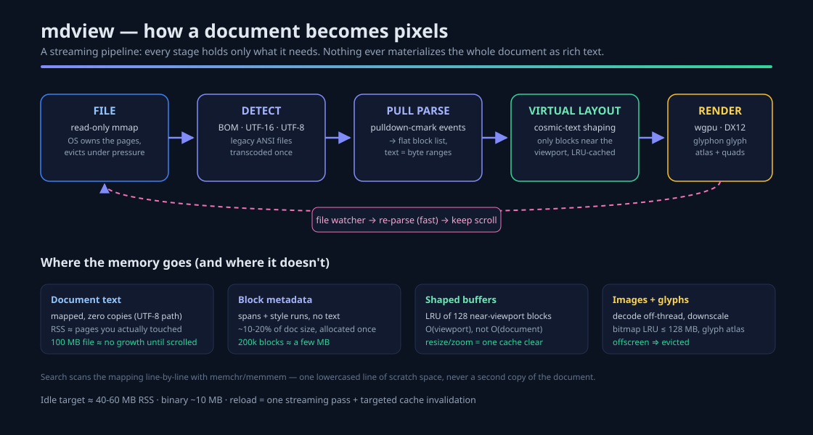
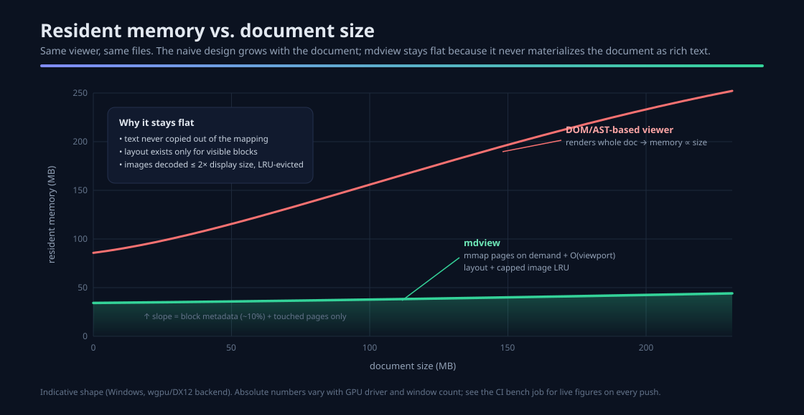
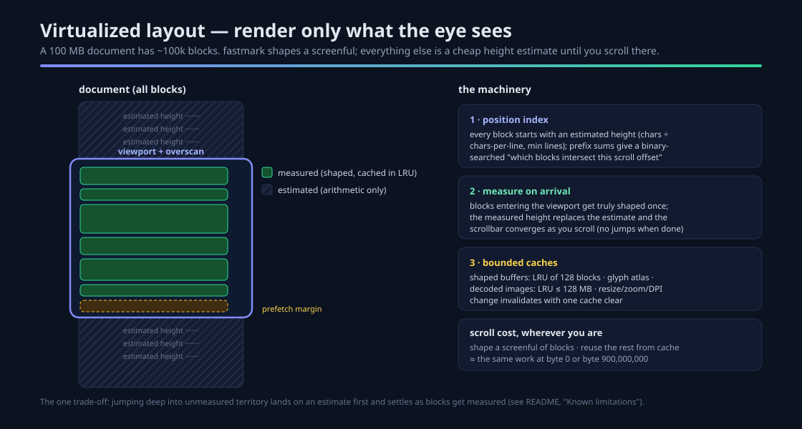

# mdview

**A fast, memory-efficient, native Markdown viewer for Windows (macOS/Linux core ready).**

[](https://github.com/dparksports/mdview/actions/workflows/ci.yml)
[](LICENSE)


mdview renders Markdown the way editors render code: a **streaming pipeline**
that never materializes the document as a rich-text tree. The file stays
memory-mapped, the parser produces a flat list of blocks addressed by *byte
ranges*, and only the blocks near your viewport are ever laid out. The result
opens 100 MB documents instantly, idles around **40–60 MB of RAM**, and keeps
scrolling at display refresh rate no matter where you are in the file.

```text
mdview README.md        # view a file
mdview --bench big.md   # headless benchmark: load, parse, shape every block
```

You can also just **drop any `.md` file onto the window**.

## Why it's fast and small



- **Zero-copy text.** UTF-8 files are mapped read-only; every rendered glyph is
  sliced straight out of the mapping. The OS page cache owns the memory and
  reclaims it under pressure — a 500 MB file costs almost nothing until you
  scroll to it.
- **Streaming parse.** [pulldown-cmark] emits events; we build a flat block
  list in one pass. No DOM, no AST. Re-parsing a 10 MB file takes tens of
  milliseconds, which is what makes live-reload free.
- **Virtualized layout.** Only blocks near the viewport are shaped
  ([cosmic-text] via [glyphon]); the rest carry cheap height estimates that
  converge to real measurements as you visit them. Layout memory is
  O(viewport), not O(document).
- **GPU rendering.** wgpu (DirectX 12 on Windows) draws an instanced-quad
  chrome pass, textured image quads, and a glyph-atlas text pass. Nothing
  CPU-rasterizes.
- **Disciplined images.** Decoded off-thread, downsampled to ≤2× display size
  before touching GPU memory, and evicted by an LRU with a hard byte budget
  (128 MB). A 4000×3000 photo never becomes 48 MB of resident RGBA.
- **Windows-realistic files.** UTF-8/UTF-16 BOMs, ANSI (Windows-1252) legacy
  files, CRLF, and network shares (SMB paths skip the mmap and read instead).



## Features

- Headings, paragraphs, **emphasis**, `inline code`, links, strikethrough
- Fenced/indented code blocks, block quotes, nested & task lists, rules
- GFM tables (rendered as aligned monospace grids)
- Block images (PNG/JPEG/GIF/WebP/BMP) with caption + placeholder frame
- Outline (TOC) sidebar with current-heading tracking — `F9`
- Incremental find with hit counter — `Ctrl+F`, `Enter`/`F3` next, `Esc` close
- Live reload on file change, keeping your scroll position
- Dark/light theme following the Windows personalization setting — `F8`
- Smooth scrolling, per-monitor DPI awareness, dark title bar
- Zoom: `Ctrl+wheel`, `Ctrl+=`, `Ctrl+-`, `Ctrl+0`

## Keyboard shortcuts

| Key | Action |
|---|---|
| `wheel`, `PgUp`/`PgDn`, arrows, `Space`, `Home`/`End` | scroll |
| `Ctrl+wheel`, `Ctrl+=` / `Ctrl+-` / `Ctrl+0` | zoom in / out / reset |
| `Ctrl+F` | find (type to search, `Enter`/`F3` next hit, `Backspace` edit, `Esc` close) |
| `F9` | toggle outline sidebar |
| `F8` | toggle dark/light theme |
| `Esc` | close find, otherwise quit |

## Virtualized scrolling



Every block begins as a height *estimate* (characters ÷ column width, minimum
line count). Blocks entering the viewport get truly shaped once, and the
measured height replaces the estimate. A prefix-sum index then answers
"which blocks intersect this scroll offset" with a binary search. The
scrollbar reflects running estimates and settles as you explore.

## Building

```bash
git clone https://github.com/dparksports/mdview
cd mdview
cargo build --release
# Windows: target\release\mdview.exe
```

Requires a stable Rust toolchain (1.82+). On Linux, install the usual
Wayland/X11 development packages (`libxkbcommon-dev libwayland-dev libx11-dev
libxcb1-dev libxrandr-dev libxi-dev libxcursor-dev`).

### Benchmarking

```bash
mdview --bench-gen 102400 > big.md   # synthesize a 100 MB markdown file
mdview --bench big.md                 # load / parse / full-layout timings + peak RSS
```

The **CI bench job** runs this on every push against a synthetic 100 MB
document — check the latest [CI runs](https://github.com/dparksports/mdview/actions)
for live numbers.

## Project layout

```
crates/mdview-core   platform-independent pipeline: mmap loader, encoding
                     detection, streaming parser, block model, search,
                     position index (fully unit-tested, no GPU deps)
crates/mdview-app    winit + wgpu + glyphon viewer: virtualized layout,
                     image store, file watching, TOC, find, themes
docs/                architecture infographics (SVG)
samples/             demo + bench documents
```

## Known limitations (v1)

- Deep jumps into never-visited territory land on estimated heights first and
  settle as blocks are measured.
- Tables render as monospace grids; no syntax highlighting in code blocks yet
  (planned: lazy syntect per visible block).
- Links are styled but not clickable in-document; local images only (no
  network fetches, by design).
- TOC sidebar shows the first 400 entries without scrolling.
- Search highlight is block-level (accent bar); glyph-precise highlight is
  planned via cosmic-text cursor APIs.

## License

Apache-2.0 — see [LICENSE](LICENSE).

[pulldown-cmark]: https://crates.io/crates/pulldown-cmark
[cosmic-text]: https://crates.io/crates/cosmic-text
[glyphon]: https://crates.io/crates/glyphon
